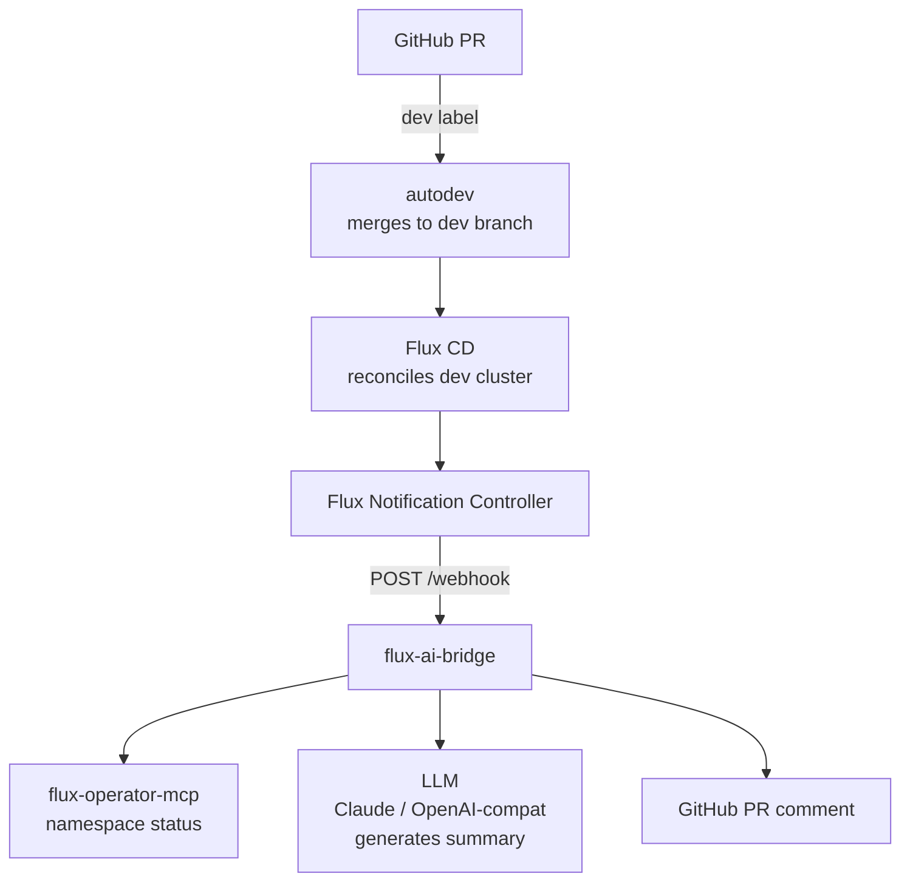

# flux-ai-bridge

`flux-ai-bridge` is a Kubernetes service that connects [Flux CD](https://fluxcd.io/) to an AI assistant. When Flux reconciles a Kustomization, the bridge receives the event, inspects every resource in that Kustomization's inventory (HelmReleases expanded to their rendered children) via [`flux-operator-mcp`](https://github.com/controlplaneio-fluxcd/flux-operator), and posts a concise deployment status comment to the GitHub pull request that triggered the change.



## Recommended workflow: autodev

Use the bridge with [autodev](https://github.com/Staffbase/autodev-action): label a pull request `dev`, autodev merges it with every other `dev`-labeled pull request into a `dev` branch, Flux deploys that branch to a dev cluster, and the bridge comments the result on each pull request, with an optional `flux-success` / `flux-failed` label as a merge gate. You test changes on a real cluster before they reach `main`, without annotating Flux objects. autodev runs on the workflow's own `GITHUB_TOKEN`.

Setup in three steps (workflow file, Flux source, bridge settings): **[docs/autodev.md](docs/autodev.md)**.

## Features

- Triggered automatically by the Flux Notification Controller — no manual invocation needed
- Queries `flux-operator-mcp` for the Kustomization's full inventory and conditions
- **Polls every inventory resource** with [`kstatus`](https://github.com/kubernetes-sigs/cli-utils/tree/master/pkg/kstatus) until each reaches a terminal state (or the per-event timeout fires) — so the analysis reflects the *settled* cluster, not an in-flight rollout
- On failures, pulls namespace Events and the failing pod's container logs (`kubectl logs -p` equivalent first, with a fallback to current logs) for context
- Finds the originating GitHub PR from the commit SHA — works for fast-forward merges, open feature branches, **and** merge commits on non-default branches ([autodev](https://github.com/Staffbase/autodev-action)-style `git merge` into `dev`) via a parent-walk fallback
- **Commit-driven by design**: a per-PR-head admission cache — keyed on `(namespace, kustomization, PR number, PR head SHA)` via `MarkPRIfNew` and governed by `DEDUPE_PR_REEVAL_TTL` — ensures one analysis per PR per push to its own branch. Flux's periodic 5-minute re-reconciles for an unchanged commit are silently dropped (see [docs/architecture.md](docs/architecture.md))
- **Deterministic comment shape**: every comment opens with `# ✅ / ❌ / ⚠️ Flux Status` and closes with an `*Analyzed by flux-ai-bridge*` footer — PR reviewers can diff-scan across consecutive analyses. The bridge swaps the marker comment only when the **cluster state** changes (idempotency is keyed on the deterministic kstatus portion, so an LLM merely re-wording an unchanged state touches nothing), and swaps **create-before-delete** so the PR never sits without a verdict; the comment's timestamp reflects the latest *state change*
- Supports **Anthropic Claude** and any **OpenAI-compatible** API — including Ollama, vLLM, Azure AI Foundry / GitHub Models (`models.inference.ai.azure.com`, Bearer auth), and Azure OpenAI Service (tenant-scoped `*.openai.azure.com`, `api-key` header with deployment-in-URL)
- **Opt-out of the LLM entirely** with `config.llm.provider=none` — the bridge posts a deterministic comment built from [`kstatus`](https://github.com/kubernetes-sigs/cli-utils/tree/master/pkg/kstatus) output alone. No API key, no model, no skill prompt. Useful for air-gapped clusters, cost-sensitive setups, or anyone who just wants the readiness table without an LLM-written summary on top
- Bundled `flux-operator-mcp` sub-chart (enabled by default) plus an optional `ollama` sub-chart for a self-contained install — disable either to point at pre-existing services

## Quickstart

### 1 — Prerequisites

- Kubernetes cluster with Flux CD ≥ 2.2 (Notification Controller enabled; the chart's Provider and Alert use `notification.toolkit.fluxcd.io/v1` on Flux ≥ 2.10, else `v1beta3`)
- `flux-operator-mcp` available in the cluster — the chart installs the bundled sub-chart by default; set `--set flux-operator-mcp.enabled=false` to skip it and point `config.mcp.url` at your own install. Flux itself does **not** need to be managed by the Flux Operator: the MCP server only reads Kubernetes resources, so Flux installed with `flux bootstrap`, `flux install` or the Helm chart works the same. The one exception is the opt-in `FAILURE_FETCH_FLUX_INSTANCE`, which reads the Operator's `FluxInstance`
- A GitHub App installed on the target repositories — see [docs/github-app.md](docs/github-app.md) for the full setup walkthrough (App ID, installation ID, private key)
- Helm ≥ 3.14
- *(Optional)* An Anthropic API key or an OpenAI-compatible endpoint — only if you want an LLM-written summary on top of the kstatus table. See "Upgrade to an LLM-written summary" below.

### 2 — Create the credentials Secret

The bridge authenticates to GitHub via a GitHub App. You'll need the App ID, the installation ID, and the App's private key (the `.pem` downloaded from the App settings page) — see [docs/github-app.md](docs/github-app.md) for how to obtain them.

```bash
kubectl create secret generic flux-ai-bridge \
  --namespace flux-system \
  --from-literal=GITHUB_APP_ID=<app-id> \
  --from-literal=GITHUB_APP_INSTALLATION_ID=<installation-id> \
  --from-file=GITHUB_APP_PRIVATE_KEY=./flux-ai-bridge.<id>.private-key.pem
```

### 3 — Install the Helm chart

From the published chart (sub-charts are bundled):

```bash
helm install flux-ai-bridge oci://ghcr.io/staffbase/charts/flux-ai-bridge \
  --namespace flux-system \
  --create-namespace \
  --set existingSecret=flux-ai-bridge
```

Or from a checkout:

```bash
# once per checkout: fetch the sub-charts pinned in Chart.yaml (or: make chart-deps)
helm repo add otwld https://helm.otwld.com/ --force-update
helm dependency update ./charts/flux-ai-bridge

helm install flux-ai-bridge ./charts/flux-ai-bridge \
  --namespace flux-system \
  --create-namespace \
  --set existingSecret=flux-ai-bridge
```

That's it. The chart's default `config.llm.provider=none` produces a bridge that posts a deterministic [kstatus](https://github.com/kubernetes-sigs/cli-utils/tree/master/pkg/kstatus) summary on every Flux event — no LLM, no API key, no per-token cost. The comment shape is the same `# ✅/❌/⚠️ Flux Status` header + `## Resource Status` table you'd get from the LLM-driven path, minus the natural-language analysis.

### 3.b — *(Optional)* Upgrade to an LLM-written summary

To add an LLM-generated `## Kustomization Status` / `## Root Cause` / `## Next steps to fix` body on top of the kstatus table:

**Claude:**
```bash
kubectl patch secret flux-ai-bridge -n flux-system \
  --type=merge -p '{"stringData":{"ANTHROPIC_API_KEY":"<your-anthropic-key>"}}'

helm upgrade flux-ai-bridge oci://ghcr.io/staffbase/charts/flux-ai-bridge \
  --namespace flux-system \
  --reset-then-reuse-values \
  --set config.llm.provider=claude
```

**OpenAI-compatible** (e.g. local Ollama, OpenAI proper, vLLM):
```bash
kubectl patch secret flux-ai-bridge -n flux-system \
  --type=merge -p '{"stringData":{"OPENAI_API_KEY":"<your-openai-key>"}}'   # omit when the endpoint doesn't auth

helm upgrade flux-ai-bridge oci://ghcr.io/staffbase/charts/flux-ai-bridge \
  --namespace flux-system \
  --reset-then-reuse-values \
  --set config.llm.provider=openai-compatible \
  --set config.llm.openaiBaseUrl=<endpoint> \
  --set config.llm.model=<model>
```

Set `openaiBaseUrl` to your endpoint, e.g. `https://api.openai.com/v1` for OpenAI proper. Left empty, the bridge uses GitHub Models (`https://models.inference.ai.azure.com`) and sends the key there, unless the bundled Ollama (`ollama.enabled=true`) wires it up.

The chart creates the Flux `Provider` and `Alert` resources by default (`flux.notification.enabled=true`) so the Notification Controller starts forwarding events immediately. Set `--set flux.notification.enabled=false` to skip them — useful when installing into a cluster without Flux (chart-testing / `helm lint`).

### 4 — Verify

```bash
# Pod is running
kubectl -n flux-system get pods -l app.kubernetes.io/name=flux-ai-bridge

# Health check
kubectl -n flux-system port-forward svc/flux-ai-bridge 8080:8080 &
curl http://localhost:8080/healthz
# → {"status":"ok"}
```

On the next Flux reconciliation that includes a commit linked to an open PR, a comment will appear on that PR. Two shapes — the header, status marker, and footer are byte-identical across both:

**Default (`provider=none`)** — the deterministic kstatus comment. The summary line is led by the Kustomization (a comment is always for exactly one), and with the chart default (`COMMENT_FAILED_RESOURCES_ONLY=true`) an all-healthy Kustomization collapses to a compact per-Kustomization row:

```markdown
<!-- flux-ai-bridge:flux-system/my-app -->
# ✅ Flux Status

Kustomization `my-app`: All 4 resource(s) and 3 pod(s) reached [kstatus](https://github.com/kubernetes-sigs/cli-utils/tree/master/pkg/kstatus) `Current`.

## Resource Status
| Kustomization | Resources | Status |
|---|---|---|
| my-app | 4 | ✅ Current |

## Workload Status
| Kustomization | Pods | Status |
|---|---|---|
| my-app | 3 | ✅ Current |

---
*Analyzed by flux-ai-bridge*
```

(Set `COMMENT_FAILED_RESOURCES_ONLY=false` to always render the full per-resource/per-pod tables instead of the compact rows.) The opening `<!-- flux-ai-bridge:<namespace>/<name> -->` is a hidden idempotency marker that lets the bridge maintain one current comment per Kustomization on each PR.

On a **failure**, the comment switches to the detailed tables — listing only the non-`Current` rows (each row's `Namespace` column locates the object). **With an LLM** (`provider=claude` or `openai-compatible`) the model's narrative is appended below the same bridge-stamped tables:

```markdown
<!-- flux-ai-bridge:flux-system/my-app -->
# ❌ Flux Status

Kustomization `my-app`: 1 of 4 resource(s) failed to reconcile.

## Resource Status
| Namespace | Kind | Name | Status | Message |
|---|---|---|---|---|
| my-app | HelmRelease | my-app | ❌ Failed | helm upgrade failed: timed out |

## Workload Status
| Namespace | Controller | Pod | Status | Message |
|---|---|---|---|---|
| my-app | Deployment/api | api-7d4f9b6c8-abc12 | ❌ Failed | container `app` CrashLoopBackOff; last run exited with code 1 |

## Kustomization Status
HelmRelease/my-app/my-app failed to upgrade — the chart's `api` Deployment
rolled out a new ReplicaSet but the pods are crashing on startup.

## Root Cause
`Pod/my-app/api-7d4f9b6c8-abc12` logs end with
`Error: missing required env var DATABASE_URL`; the PR removed the
`databaseUrl` value from `values.yaml` without adding it back via a
Secret.

## Next steps to fix
1. Restore `databaseUrl: …` in `my-app/values.yaml`, OR
2. Add a Kubernetes Secret `my-app-db` with the URL and reference it from
   the HelmRelease `valuesFrom`.

---
*Analyzed by flux-ai-bridge*
```

The `## Resource Status` and `## Workload Status` tables are **bridge-stamped and byte-identical across modes** — the LLM never authors them. Reviewers see the same canonical kstatus rendering at the top of every comment, with the model's prose (`## Kustomization Status`, plus `## Root Cause` + `## Next steps to fix` on failures) appended below. Data on top, interpretation below; the model can't drift columns, drop a row, or hallucinate a status.

> **LLM token cost-saver:** on healthy reconciles the LLM is short-circuited by default (`LLM_SKIP_ON_HEALTHY=true`) — the body is just the deterministic tables, identical to no-LLM mode. Set `config.llm.skipOnHealthy: false` to keep the LLM in the loop on every event.

## Documentation

| | |
|---|---|
| [The autodev workflow](docs/autodev.md) | **Recommended:** test pull requests on a dev cluster with autodev, setup in three steps |
| [Getting Started](docs/getting-started.md) | Full installation guide, Flux setup, workflow walkthrough, troubleshooting |
| [Configuration Reference](docs/configuration.md) | All environment variables and Helm chart values |
| [Architecture](docs/architecture.md) | Component diagram, request flow, design decisions |
| [vs. Flux's native PR commenters](docs/vs-flux-native-pr-comments.md) | When to prefer this over `githubpullrequestcomment` (and when not) — autodev / multi-PR-per-branch story |
| [Customizing SKILL.md](docs/skill.md) | The LLM system prompt — what's in the bundled version and how to extend or replace it for org-specific conventions |
| [Developer Guide](docs/development.md) | Build, run locally, add a new LLM provider, release process |

## Contributing

Contributions are welcome. See [CONTRIBUTING.md](CONTRIBUTING.md); contributors sign the [CLA](CLA.md) on their first pull request.

## License

Copyright 2026, Staffbase SE and contributors. Licensed under the [Apache License, Version 2.0](LICENSE).
