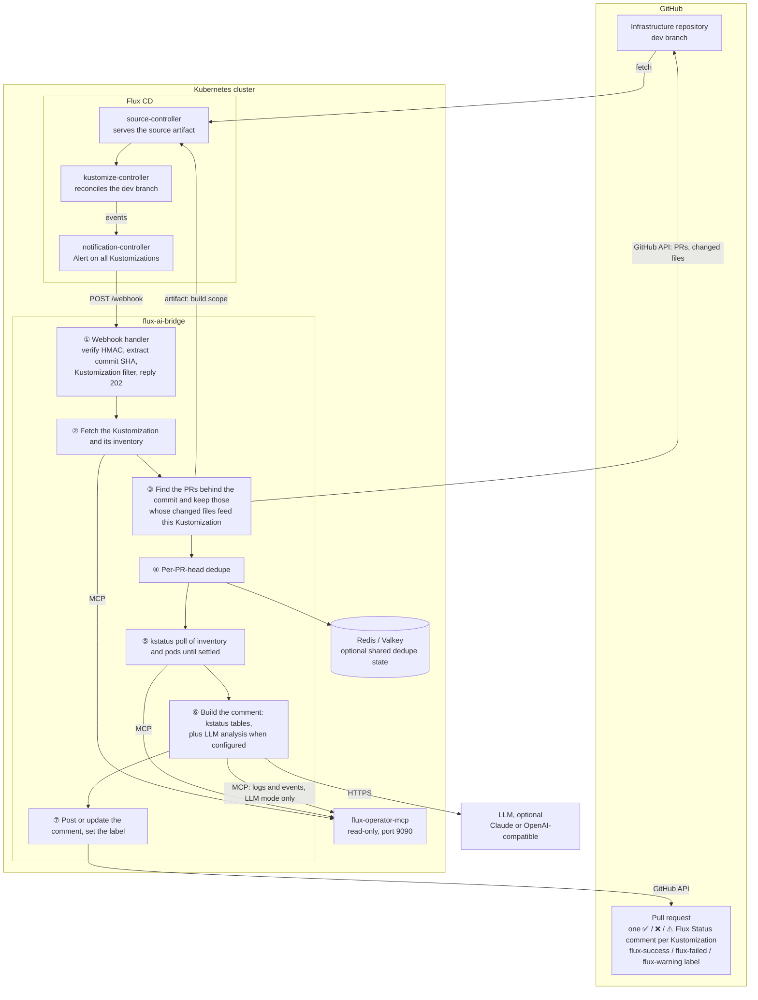

# Architecture

## Overview

`flux-ai-bridge` is a lightweight Go HTTP service that bridges the Flux CD Notification Controller with an LLM to produce human-readable deployment status comments on GitHub pull requests.

It runs inside the Kubernetes cluster as a `ClusterIP` service. The Flux Notification Controller pushes events to it; it never reaches out to the cluster API until triggered.

---

## Component Diagram



---

## Request Flow

### Step-by-step

1. **Flux Kustomization reconciles** — a commit from the `dev` branch is applied.
2. **Notification Controller fires** — an HTTP `POST` is sent to `flux-ai-bridge/webhook` with a JSON payload containing the Kustomization name, namespace, revision (e.g. `main@sha1:abc1234`), and severity/reason metadata.
3. **Webhook handler** — validates the request, extracts the commit SHA from the revision string, and runs the **Kustomization-name admission filter** (`config.kustomizations.{include,exclude}` globs — drops events that don't match `include` or do match `exclude`). Dedup happens in the per-PR step below (keyed on each PR's own head commit), so the handler just queues the event and returns `202` immediately; the pipeline runs asynchronously (up to `WEBHOOK_MAX_CONCURRENT` at once, up to 4× that waiting; beyond that it answers `503`, which notification-controller retries a few times).
4. **MCP client** — calls `flux-operator-mcp` over HTTP MCP to fetch the Kustomization resource (its `status.inventory` is the source of truth for the resources Flux applied). **Revision-applied gate:** if the Kustomization's `status.lastAppliedRevision` does **not** match the revision this event is about, the bridge **defers** — returns without analysing. Until the controller has actually *applied* the analysed revision the inventory/pod snapshot still describes the *previously-running* state, so a green readout would describe the old deploy, not the change under review. It's purely event-driven, no timeout: when the apply lands, the controller emits its own `ReconciliationSucceeded` for that revision which re-triggers analysis, so the readiness settle budget only ever counts down against the *applied* revision. Only a confident mismatch defers (both revisions present and different); a blank/unparseable `lastAppliedRevision` falls through unchanged — except while the Kustomization's `Ready` condition is present and not `True` (its first apply is still in progress), which defers too. Before a ✅ verdict is recorded the bridge re-reads the Kustomization; if it was recreated (another UID) or has applied a different revision since, the verdict is deferred to that revision's own event; if its reconcile of the analysed revision now reads `Ready=False` (a retry that failed meanwhile), it is deferred to that failure's own event (`reason="revision_not_applied"` for both). Deferred events are counted as `flux_ai_bridge_prs_skipped_total{reason="revision_not_applied"}`.
5. **GitHub repo discovery** — if `GITHUB_REPO` is not set, the bridge reads the Kustomization's `spec.sourceRef`, fetches the GitRepository, and parses `spec.url` to extract `owner/repo`.
6. **PR discovery** — calls `FindPRsForCommit(owner, repo, sha)`. Combines `GET /commits/{sha}/pulls` with a walk of merge-commit parents back to the merge base with the default branch (at most `PARENT_WALK_DEPTH` hops, default 200), probing each merge commit's `parents[1..]` so commits batched into a non-default branch (e.g. [autodev-action](https://github.com/Staffbase/autodev-action) style `git merge` into `dev`) still resolve to their open PRs. The walk runs even when the direct lookup finds a PR, so a deployed branch that is itself the head of an open PR (a promotion PR) doesn't hide the PRs merged into it; results are deduplicated by PR number. Each resolved PR carries its own **head commit SHA**. Each open PR is then **attributed**: it is kept only if one of its changed files is part of this Kustomization's kustomize build (resolved from the source-controller artifact) and declares a resource in its inventory, or is a build input such as a patch or generator file; deletions are attributed from the Kustomization's prune events.
7. **Per-PR dedup** — for each matching open PR, `MarkPRIfNew(ns, name, prNumber, prHeadSHA, ttl)` admits it exactly once per **its own head commit**. PRs already analysed at their current head are skipped here, *before* the readiness poll and LLM run — so an unrelated advance of the Flux source branch (which changes the Kustomization's revision but not the PR's head) doesn't re-analyse or churn the comment. If no PR survives, the pipeline stops before the expensive steps.
8. **Inventory expansion** (gated by `READINESS_EXPAND_HELMRELEASES`, default true) — for every HelmRelease in the Kustomization's inventory the bridge fetches the HelmRelease YAML via MCP and folds its own `status.inventory.entries` (or `status.history[].inventory[]` in MCP's structured shape) into the readiness ref list. One level only. Surfaces the chart-rendered Deployments/Services/etc. that would otherwise be invisible behind the HelmRelease wrapper.
9. **Readiness check** — polls every (expanded) inventory entry via MCP (`WaitUntilSettled`), running `kstatus` evaluation on each. The loop stops when every row reaches a terminal kstatus (`Current` / `Failed` / `Terminating`) or `READINESS_POLL_TIMEOUT` elapses (rows that are `NotFound` are intentionally re-polled until the timeout to guard against transient MCP discovery/cache misses). A snapshot counts as settled only when a fresh read of the (expanded) inventory refs still matches the refs it checked: a HelmRelease that finishes its install between the two reads can read `Current` before its new children are in the refs. The last sleep stops at the timeout, and each poll's MCP reads are bounded by it too (at least 1s per poll): a read cut short reads `Unknown`, so the poll ends unsettled instead of running past the timeout. A cancelled pipeline never reads as settled. This prevents analyzing partial state on a Flux event that fires before the workload has finished rolling. **Child Kustomizations are excluded from the poll:** an inventory entry that is itself a Flux `Kustomization` (an "app-of-apps" parent whose inventory is 100+ child Kustomizations) is *not* checked — each child reconciles independently on its own schedule and is analysed on its own event, so requiring every child `Current` at once is both unrealistic (right after a push many are mid-reconcile) and stricter than Flux itself (a `wait: false` parent reports `Ready` once children are *applied*, not healthy). Instead the parent's **own** `Kustomization` object is polled (its `Ready` condition reflects whether it applied cleanly), alongside any **non-Kustomization** resources it directly manages (workloads, HelmReleases-expanded, GitRepositories, …). So an aggregate parent settles on its own status rather than perpetually timing out into a `⚠️ Warning`, while a broken resource it directly owns still surfaces. **Intentional deletions are not failures:** after the poll, any `NotFound` rows are checked against a **fresh** inventory read — rows whose entries are gone from the current inventory were pruned (e.g. the PR deletes the resource) and are dropped from the report, and `settled` is recomputed so a prune doesn't read as a poll timeout. Rows still listed yet `NotFound` stay failures. An empty fresh inventory is only trusted when the Kustomization's own `Ready` condition is `True` (a PR deleting the *last* resources legitimately empties it; a failing or mid-reconcile object can transiently report none).
10. **Pod kstatus wait** (gated by `READINESS_INCLUDE_PODS`, default true) — scan of pods in the **Kustomization's own namespace** (its `spec.targetNamespace` if set, else its name — the common convention where Kustomization `grafana` deploys into the `grafana` namespace), re-run until every pod reaches a terminal kstatus (`Current`/`Failed`/`Terminating`) or the **shared** `READINESS_POLL_TIMEOUT` budget (the same deadline as the inventory poll, minus what it already consumed) elapses. This is what stops the bridge analysing a workload mid-rollout: a Deployment can read `Current` while its freshly-created pod is still `Running, containers not all ready` (`InProgress`), and a one-shot snapshot would capture that transient state. A `Running` pod whose containers are ready but whose own `Ready` condition isn't `True` (a pending readiness gate) stays `InProgress` too. A *starting* pod (`InProgress`) is waited out into `Current`; a *genuinely failing* workload pod (`isFailingPod` → `Failed`, terminal) ends the wait at once so failures aren't slowed (a failed Job pod still waits out the quiet period below); a pod stuck `InProgress` past the budget is reported as partial state (`settled=false`). **Quiet period** (`READINESS_POD_QUIET_PERIOD`, default 60s): settled pods count as settled only once the namespace has been quiet that long — no workload pod appearing and none shutting down — counted from the start of the readiness poll (so the inventory poll's time counts) or the last such change, whichever is later. The quiet period must have elapsed by the **start** of the scan that confirms it: a pod created while a slow scan ran is in none of its rows. Each scan's MCP reads are bounded by the remaining budget (at least 1s per scan), so a slow read can't eat the time reserved for analysis. A pod that shows up in a later scan appeared when the bridge saw it, so clock skew between the API server and the bridge can't hide it; a pod already there at the first scan counts from its `creationTimestamp` if that is earlier, so one created while the inventory poll ran counts too. A pod recreated under the same name is a new pod, and the bridge remembers every pod it saw, so one that comes and goes between scans still counts. A workload pod shutting down holds the window open: a StatefulSet creates the replacement only once the old pod is gone. A workload pod that vanished between two scans restarts the window, since it may have shut down without either scan seeing it terminate. Operators create their workload pods only after Flux applied the custom resource, and kstatus reads a resource with no conditions `Current` as soon as it exists — so without the window the namespace can look settled before those pods exist, and the PR reads healthy off pods that were never judged. A new pod restarts the window even when it is already ready; Job pods don't, so a frequent CronJob can't hold it open. A `Failed` workload pod skips the window; a failed Job pod doesn't, since it may belong to a superseded CronJob run that is dropped later. The last sleep stops at the budget. A window the shared budget cuts short ends unsettled (⚠️), in line with fail closed. **CronJobs are judged by their most recent run only:** the Jobs a CronJob owns (an ownerReference to the CronJob, named `<cronjob>-<schedule-slot>`, read from the one `batch/v1` Job list) are grouped per CronJob and only the newest slot's pods are kept — finished Jobs linger per `{successful,failed}JobsHistoryLimit`, and an old run's failed pod must not outvote a newer run that succeeded (nor add noise next to a newer run that failed). When the newest run's pods are **already cleaned up**, the run is judged from its Job object's own conditions instead — `Failed=True` → ❌, `Complete=True` → ✅, otherwise `InProgress` (⚠️) — so a CronJob that fails every run reads a stable ❌ across the between-runs gaps rather than flapping with pod-history pruning. A newest run with `Failed=True` none of whose remaining pods reads `Failed` (a run with several completions that hit its deadline after one pod succeeded) gets the same ❌ row, so its succeeded pod can't read it green. One-shot Jobs without a slot suffix, and standalone Jobs that merely end in digits, are separate workloads. If the Job list fails, nothing is dropped: every run's pods stay in the report.
11. **Failure-context fetch** (only when severity is `error` or any inventory row is non-`Current`) — for each inventory namespace, fetches Events, identifies failing pods (`CrashLoopBackOff`, restart-and-not-ready, etc.), and pulls the container logs of up to 3 failing pods (`previous=true` first, falling back to current). Which pods' logs are pulled depends on `FAILURE_FETCH_LOGS_SCOPE`: with `owned` (default) only pods owned by a workload in the Kustomization's inventory (HelmRelease children included), resolved through `ownerReferences` as in the pod snapshot (Pod → ReplicaSet → Deployment; StatefulSet, DaemonSet, Job; a CronJob's Job one hop further), so in a shared namespace logs of unrelated apps never reach the prompt or an external LLM. A pod whose owner can't be resolved is left out, and a `## Pod Logs — not included` note tells the model how many failing pods' logs it doesn't have, so it doesn't guess them. With `namespace` any failing pod's logs are pulled. The scope affects only logs: the failing pods used for events and for the hard-failure signal are the same in both modes. Events older than the failing pods are filtered out as stale (a `FailedCreate` of a non-`Current` workload is kept: it is about the workload, not a pod). This extra fetch builds LLM prompt context and runs only in LLM mode. Note that each non-`Current` entry's own `.status.conditions[]` (the controller's root-cause message — e.g. a HelmRelease's `SourceNotReady: HelmRepository … not found`) is surfaced separately in the deterministic comment body in **both** modes, since the readiness checker already captured it during the poll.
12. **Analysis decision** — three paths:
    - `LLM_PROVIDER=none` → analyzer is nil; the bridge builds the comment body from kstatus output alone (no skill prefix, no LLM call).
    - `LLM_SKIP_ON_HEALTHY=true` (default) AND settled AND every inventory row + every pod is `Current` AND the Kustomization's own reconcile is not failing → LLM is short-circuited; the same kstatus body fills in. Saves a paid round-trip on healthy reconciles.
    - Otherwise → sends the aggregated payload (Flux event + Kustomization YAML + Resource Readiness + Workload Readiness + failure context) to the configured LLM with the SKILL.md system prompt. The LLM produces the comment body (no header/footer). On a non-healthy outcome the reply must carry the SKILL-mandated `## Root Cause` and `## Next steps to fix` sections; a reply that lacks them as real headings (headings inside code blocks don't count) is retried once with a corrective instruction (then posted as-is with a WARN if the model still won't comply). The exception is a rollout still in progress — the pod scan succeeded, every non-Current resource (cluster-scoped ones included) is in the scanned namespace, and every non-Current resource and pod is `InProgress` with no failure reason — no `Ready=False`, `Stalled=True` or failure-named reason (`rolloutInProgress`): the payload gets a `## Rollout In Progress` note, the SKILL tells the model to omit both sections, no retry is made, and sections the model writes anyway are removed (`stripFailureSections`). Without this, the model would name routine pod-replacement events (probe failures, volume re-attach) as the root cause. Before posting, @-mentions in the reply's prose get a zero-width space so text quoted from logs can't notify anyone; code spans and fenced blocks stay unchanged.

    **A failing reconcile always reads ❌, however green the snapshot looks:** when the triggering event has `error` severity or the fetched Kustomization's `Ready` condition is `False` (dry-run rejection, build/apply failure), the analysed revision never reached the cluster, or only in part — the all-`Current` inventory describes the *last good* state, not the PR's. (After a failed health check or prune the revision was applied, but Flux still reports it as failed.) The outcome is forced to failure and the comment summary leads with the controller's failure message. One carve-out: reason `DependencyNotReady` (from either source) is a self-resolving ordering state — the Kustomization is queued behind a `dependsOn` target, not broken — and reads ⚠️/`flux-warning`, with the summary leading "waiting on a dependency: …".
13. **Comment posting** — for each surviving PR the bridge wraps the body with the deterministic `# <emoji> Flux Status` header + `*Analyzed by flux-ai-bridge*` footer via `formatComment`, then delivers it idempotently against the per-Kustomization marker `<!-- flux-ai-bridge:<namespace>/<name> -->`. Idempotency is keyed on the **stability key** — the deterministic kstatus portion of the body, NOT the full body — so an LLM that merely re-words an identical cluster state never causes a swap: **unchanged state** → nothing is touched (no LLM call on re-evals, no GitHub write, no notification); **changed state** → the fresh comment is **created first, then** the prior one deleted (create-before-delete: a crash between the calls leaves a brief duplicate that the next sweep removes, never a missing verdict; delete failures are tolerated with the cache cleared so the next post re-sweeps). The per-Kustomization marker lets multiple Kustomizations on the same PR each maintain their own current comment.

If the pipeline errors at any step after a PR was marked, the processor rolls back that PR's dedup mark (`ForgetPR`) so the next event re-admits it — except on GitHub rate-limit errors, where every undelivered mark is put on a cooldown until the limit resets (GitHub's `Retry-After` or reset time, clamped to 1m–1h; 10m without a hint): Flux re-fires during it stay deduped instead of hammering the API into a longer cooldown, and the first event after it retries.

### Timing characteristics

- The webhook returns `202 Accepted` immediately.
- The full pipeline (MCP + readiness poll + LLM + GitHub API) typically completes in a little over `READINESS_POD_QUIET_PERIOD` (60s by default) for a healthy workload, since settled pods wait out the quiet period. A workload still rolling can extend it up to `READINESS_POLL_TIMEOUT` (3 min default).
- Comments are deterministic: same cluster state + same Kustomization always produces the same `# Flux Status` shape. Per-PR-head dedup prevents re-analysis on Flux's periodic re-reconciles, and idempotent delivery means even a re-analysis (e.g. after the re-eval TTL) only touches the comment when the rendered body actually changed.

---

## Internal Packages

| Package | File | Responsibility |
|---|---|---|
| `config` | `internal/config/config.go` | Load and validate all configuration from environment |
| `webhook` | `internal/webhook/handler.go` | HTTP server, parse Flux notification payload, extract commit SHA, run Kustomization-name admission filter, spawn the processor goroutine (dedup lives per-PR in the processor) |
| `kustomizations` | `internal/kustomizations/filter.go` | Glob-based admission filter (`config.kustomizations.{include,exclude}`); include-then-exclude (deny wins); patterns validated at startup |
| `dedupe` | `internal/dedupe/cache.go` | Per-(namespace, kustomization, PR, PR-head-sha) admission cache (`MarkPRIfNew`/`ForgetPR`), owned by the processor; optional Redis/Valkey backend for cross-replica + cross-restart sharing |
| `mcp` | `internal/mcp/pool.go` | HTTP MCP session pool for `flux-operator-mcp`; also exposes `GetKubernetesAPIVersions` used at startup to populate the readiness Resolver |
| `readiness` | `internal/readiness/checker.go` | Poll inventory until every row reaches a terminal kstatus, or timeout. Uses a (group,kind)→apiVersion `Resolver` populated from MCP discovery so non-v1 CRDs route to the correct GVR (the Flux inventory ID format omits the version) |
| `llm` | `internal/llm/interface.go` | `Analyzer` interface + `NewAnalyzer` factory |
| `llm` | `internal/llm/claude.go` | Anthropic Claude implementation |
| `llm` | `internal/llm/openai.go` | OpenAI-compatible implementation (Ollama / vLLM / Azure AI / Azure OpenAI Service / OpenAI) |
| `github` | `internal/github/commenter.go` | Find PR by commit SHA (direct + merge-parent walk), idempotent comment delivery (skip-if-unchanged, else delete-and-recreate) |
| `processor` | `internal/processor/processor.go` | Orchestrate MCP → readiness → failure-context → LLM → GitHub pipeline; wrap output with deterministic header/footer |
| `skills` | `internal/skills/loader.go` | Load `/skills/SKILL.md` (the single file mounted from the ConfigMap rendered by [charts/flux-ai-bridge/templates/configmap-skill.yaml](../charts/flux-ai-bridge/templates/configmap-skill.yaml)) as the LLM system-prompt prefix; see [docs/skill.md](skill.md) for how to override or extend it |

---

## Key Design Decisions

### Dedupe cache (per-PR-head processing)

Flux's Notification Controller re-fires `ReconciliationSucceeded` events on every Kustomization reconcile pass — typically every 1–5 minutes — and, on a shared GitOps branch, *every* Kustomization re-reconciles whenever anything merges, so the source revision advances constantly. Keying dedup on the source revision would re-analyse an open PR (and churn its comment) on every unrelated merge. So dedup is keyed on the **PR's own head commit** instead.

- **Key**: `(namespace, kustomization-name, PR-number, PR-head-sha)`. A PR is analysed once per push to *its own* branch, regardless of how many times the Flux source revision moves underneath it. The dedup decision lives in the processor (`MarkPRIfNew`), *after* PR resolution — it needs the PR head SHA, which isn't known until the PRs are resolved.
- **Default mode**: no time-based expiry. An entry persists until one of:
  - LRU bound (4096 entries) evicts it.
  - The processor rolls back the mark (`ForgetPR`) on a pipeline error / panic — so a transient failure doesn't poison the slot for the retry. (Rate-limit errors are the exception: the mark is kept to avoid re-firing into a longer GitHub cooldown.)
  - Process restart, when the cache is in-memory.
- **Re-evaluation floor** via `DEDUPE_PR_REEVAL_TTL` (env var or Helm value): unset/`0` (default) → analyse each PR-head exactly once. A positive duration (e.g. `30m`) lets the admission record expire so a later event re-checks the head's current cluster state — used to track an unhealthy deploy until it resolves. Whether it ALSO catches runtime drift on a *green* deploy (a pod that crashloops minutes after a green analysis) depends on `DEDUPE_REEVAL_FAILED_ONLY`: with the default `true`, green heads are frozen and such drift is NOT picked up until a new commit; only `DEDUPE_REEVAL_FAILED_ONLY=false` re-checks green heads for drift. Idempotent comment delivery means a re-eval that finds identical state writes nothing. Enabling the floor on a running install also migrates marks written before it (the Redis backend attaches the expiry via `EXPIRE NX` — requires Redis ≥ 7.0; any Valkey qualifies). By default (`DEDUPE_REEVAL_FAILED_ONLY=true`) a previously-green head is **frozen** — never re-analysed until the PR gets a new commit; nothing (error event or runtime drift) re-wakes it, so an unrelated sibling failing in a shared Kustomization can't flip a green PR. On Redis/Valkey the freeze rests on the head's success record, which only events past the floor refresh and which outlives each admission mark by 7 days (or one more floor, if longer); once it lapses, the next event analyses the unchanged head as new. Failed/warning heads are still re-checked each window. Collateral damage from the PR's own change is still caught at the first (whole-inventory, ungated) analysis — a PR only reaches green if every dependent was healthy then. Set `DEDUPE_REEVAL_FAILED_ONLY=false` to re-evaluate every attributed head each window (re-checks green heads for post-green drift, at the cost of flipping green PRs on sibling failures). `DEDUPE_PR_REEVAL_MAX` optionally caps re-evals per head so a never-recovering deploy stops burning readiness polls + LLM calls — the budget meters **failing analyses only** (healthy skips and healthy results are free), a new commit always resets it, and an exhausted PR still **piggybacks** on analyses sibling PRs of the same Kustomization trigger, so its comment keeps tracking the verdict at zero extra analysis cost (skips surface as `flux_ai_bridge_prs_skipped_total{reason="reeval_exhausted"}`).
- **`DEDUPE_TTL`** (env var or `config.dedupe.ttl` Helm value) is a separate, coarser knob: it sets a global expiry on the **in-memory** backend only — it is ignored when Redis/Valkey persistence is configured — and `0` disables dedup entirely (every event runs the pipeline — the idempotent comment layer still prevents duplicate comments). For per-PR re-evaluation prefer `DEDUPE_PR_REEVAL_TTL`.

#### Persistent dedupe (optional)

The default cache is in-memory: a bridge restart wipes it, and the first event after restart for an already-analysed PR-head re-runs the pipeline (wasted compute). The comment itself is **not** churned — idempotent delivery sees the rendered body is unchanged and writes nothing — and a single replica is still correct. Set `DEDUPE_PERSISTENCE_URL` (or `config.dedupe.persistence.url` Helm value) to a Redis-protocol endpoint to make the cache survive restarts and, critically, to coordinate **multiple replicas** (see below).

The Helm chart bundles a [Valkey](https://valkey.io/) sub-chart for the self-contained case. Enable it with `valkey.enabled=true`; the chart auto-wires `DEDUPE_PERSISTENCE_URL` to the in-cluster Service. Leave the sub-chart disabled and set `config.dedupe.persistence.url` directly to point at any Redis-protocol-compatible service:

- External Valkey or Redis (self-hosted)
- AWS ElastiCache (Redis or Valkey engine)
- GCP Memorystore
- Azure Cache for Redis
- Any other RESP server

Valkey is a fork of Redis 7 and is wire-compatible — the bridge's client speaks Redis protocol, so it doesn't care which flavour is on the other end.

**Failure model:** the dedupe admission fails **closed**. If Valkey/Redis errors on the `MarkPRIfNew` check, the bridge logs an ERROR, increments `flux_ai_bridge_prs_skipped_total{reason="dedupe_unhealthy"}`, and **skips** that PR rather than running the pipeline for it — without dedupe coordination there is no at-most-once guarantee across replicas, and fail-open would burn LLM tokens and risk uncoordinated duplicate comments on every Flux re-fire (~12/hour at the standard 5-minute interval) for the whole duration of an outage.

**Concurrency:** `MarkPRIfNew` uses `SETNX` so the admission decision is atomic across multiple bridge replicas. If you ever scale `replicaCount` above 1, persistent dedupe is what lets all replicas share state. (With in-memory dedup and multiple replicas, each pod admits independently and could double-post; the idempotent comment layer narrows but doesn't fully close that race — so multi-replica requires Redis.)

#### Several clusters, one repository

Bridges in different clusters that report on the same repositories set a distinct `INSTANCE_ID` each. The ID goes into the comment marker and the Redis key prefixes, so every instance keeps its own comment per Kustomization (two clusters with a `flux-system/apps` Kustomization no longer claim or delete each other's comment) and its own dedupe and cache state, even on a shared Redis. Labels are per PR, not per instance, so each instance needs its own label names.

#### High availability (multi-replica)

`replicaCount > 1` is supported as **active-active** with persistent dedupe as the coordination primitive. Every replica accepts every webhook from Flux Notification Controller; the SETNX call inside `MarkPRIfNew` admits exactly one replica per (PR, head commit), and the others skip that PR without a GitHub write. There is no leader gate at `/readyz` and no 503 on follower replicas — both would hurt operability:

- A `/readyz` gate would drop follower pods from the Service's Endpoints list (`0/1 Ready` in `kubectl get pods`), which most cluster-level alerting flags as a problem even though the pod is healthy and hot-standby.
- A handler-level 503 gate would charge every follower with one HTTP error per inbound webhook, eroding any SLO measured on HTTP error rate.

The chart enforces the invariant: `replicaCount > 1` (or `autoscaling.enabled`) without `config.dedupe.persistence.enabled=true` fails `helm template` with a clear error. The fix is one of:

- bundled: `valkey.enabled=true` + `config.dedupe.persistence.enabled=true` (the defaults)
- external: `config.dedupe.persistence.url=redis://...` + `enabled=true`

All replicas share that one dedupe store, and dedupe fails closed, so the store needs the same availability as the bridge. The bundled Valkey defaults to a single pod without Sentinel, which is a single point of failure. For high availability, use its Sentinel setup (`valkey.replica.enabled`, `valkey.sentinel.enabled`, `valkey.persistence`, `valkey.sentinel.password`, plus `config.dedupe.persistence.sentinel.enabled`) or an external highly available Redis/Valkey.

### GitHub-fetch caching

The dedupe cache covers same-SHA re-fires (whole pipeline short-circuit). For the in-pipeline GitHub API calls — blob fetches, commit metadata, PR lookups, and comment-list scans — there's a separate fetch cache layer ([internal/fetchcache](../internal/fetchcache/)) keyed by content-addressed SHAs (immutable, no TTL) for blob + commit data and short-TTL keys for PR state. The fetchcache automatically reuses the dedupe cache's Redis connection when persistent dedupe is enabled, so operators configure Valkey/Redis once for both layers.

At scale — autodev batches merging dozens to hundreds of PRs into a dev branch — this layer is what keeps the bridge inside GitHub's 5,000/hour App rate limit. See [docs/caching.md](caching.md) for the full caching guide: what each surface caches, why each TTL was chosen, how force-push is handled, hit-rate expectations, and tuning knobs for very large autodev workflows.

### Idempotent GitHub comments

Every comment is wrapped with a per-Kustomization HTML marker `<!-- flux-ai-bridge:<namespace>/<name> -->`. Delivery is **idempotent on the stability key** — the deterministic kstatus portion of the body (a SHA-256 of it is cached alongside the comment ID). The LLM narrative is deliberately excluded from the key: it re-words identical state on every analysis, so hashing the full body would swap the comment on every re-eval of a persistently failing PR (notification churn):

- **Unchanged state** (same stability key) → nothing is touched. No GitHub write, no notification, no timestamp churn — and on re-evals the LLM round-trip is skipped entirely (`CommentCurrent` is consulted before the call). This is the steady-state path: per-PR-head dedup already prevents most re-analysis, and this catches the rest (e.g. a re-eval that finds identical state, or a cold cache after restart).
- **Changed state** → the fresh comment is **created first**, then the prior marker comment **deleted** (create-before-delete: a crash or pod termination between the calls leaves a brief duplicate, swept by the next pass, instead of a PR with no verdict). The reviewer gets a notification and a new timestamp for the updated verdict (GitHub sends nothing on an in-place edit, which would let a ✅→❌ flip land silently); recreate-on-change is used over edit-in-place for exactly this reason. Post-create delete failures are tolerated (the verdict is live) — the cache entry is cleared so the next post re-enters the list-based sweep and removes leftovers.

The per-Kustomization scoping means a PR that touches multiple Kustomizations gets multiple bridge comments — each independently maintained. The unscoped marker (`<!-- flux-ai-bridge -->`) is also recognized on read; only the per-Kustomization marker is emitted.

**Opt-in history** (`GITHUB_KEEP_COMMENT_HISTORY=true` / `config.github.comments.keepHistory=true`): the skip/delete steps are bypassed and every analysis appends a fresh comment. The PR accumulates a chronological trail — useful when iterating on a workload that toggles between healthy and broken across commits, or for audit-trail-style review processes.

### Deterministic comment shape

Every comment posted by the bridge has the same structural shape, guaranteed by `formatComment` in the processor:

```
# <emoji> Flux Status            ← header; the emoji is the bridge's kstatus verdict

Kustomization `<name>`: …        ← summary line (COMMENT_INCLUDE_SUMMARY)
## Resource Status               ← tables built by the bridge from kstatus,
## Workload Status                 identical with and without an LLM
## Kustomization Status          ← LLM narrative (LLM mode only); on failures
## Root Cause                      also Root Cause + Next steps to fix
## Next steps to fix

---
*Analyzed by flux-ai-bridge*     ← attribution byline (COMMENT_INCLUDE_FOOTER)
🔁 Re-evaluated automatically …   ← static auto-retry policy line (non-green comments only, when re-eval is enabled)
```

The bridge builds everything above the narrative itself (`buildKstatusBody`): the status marker on its first line, the summary and the tables. The LLM's reply, if any, is appended below the tables after any marker the model emitted is stripped — the skill (`charts/flux-ai-bridge/templates/configmap-skill.yaml`) tells it not to write a header, footer, status marker or the status tables. `formatComment` defensively strips any header/footer anyway, lifts the marker from the body's first line into the `# <emoji> Flux Status` header, and re-stamps both wrappers. This is idempotent — passing an already-wrapped string through yields the same output. On a **non-green** outcome with re-evaluation enabled it also appends a single static auto-retry policy line (`🔁 Re-evaluated automatically up to <max>×, at most once every <ttl>, until it passes.`), with `<max>`/`<ttl>` read from `DEDUPE_PR_REEVAL_MAX` / `DEDUPE_PR_REEVAL_TTL`. It is a STATEMENT of policy, not a live countdown, so it stays identical across re-evals and never churns the comment on unchanged state (which would otherwise skip both the LLM call and the GitHub write); it is part of the stability key, so it only appears/disappears when the outcome crosses the success boundary. Because it is operational information rather than authorship metadata, it renders **independently of `COMMENT_INCLUDE_FOOTER`** — disabling the attribution byline still keeps the retry note.

### PR-from-commit discovery (two-layer)

`FindPRsForCommit(owner, repo, sha)` exists because GitHub's `GET /commits/{sha}/pulls` has a sharp edge: it only returns **merged** PRs when the commit is on the repository's **default branch**. For non-default deploy branches (a common GitOps pattern: PRs targeting `main`, but Flux watching `dev`), that endpoint returns empty even when an open PR clearly produced the commit.

- **Layer 1** — direct lookup: `ListPullRequestsWithCommit`. Fast-forward merges and open-feature-branch SHAs resolve here.
- **Layer 2** — merge-commit parent walk, also when layer 1 found PRs (a deployed branch can itself be the head of an open promotion PR): fetch the commit metadata. If the walk fails, the direct matches are kept and the incomplete result isn't cached, so the next event walks again. If it's a merge commit, `parents[1..]` are merged-in branch tips (which ARE on a PR's head branch); probe each via `commits/{parent}/pulls`. If `parents[0]` is itself another merge commit (autodev batched several PRs into one push), recurse. The walk stops at the **merge base with the default branch**: below it the history is already merged, so its merge commits only resolve to merged PRs, which the bridge skips. This matters when the default branch itself merges with merge commits — an autodev branch is the default branch's tip plus one merge per PR, and without the stop the walk would continue through the default branch's own history. The merge base costs one `GET /repos/{owner}/{repo}` and one `compare/{default}...{sha}` call, made only once the chain reaches a second merge commit and cached per commit. When it can't be determined (unrelated histories, an API error), the walk runs to the first plain commit as before. Either way it is capped at `PARENT_WALK_DEPTH` hops (default 200) to bound API cost.

The whole resolution is wrapped in a **single-flight** group keyed on `(owner, repo, sha)`: the burst of concurrent events one new revision triggers (one per Kustomization) collapses to a single walk — the first caller resolves and warms the cache, the rest block on it and reuse the result. See [caching.md → Concurrent resolution](caching.md#concurrent-resolution-single-flight).

This is the reason flux-ai-bridge doesn't require the `event.toolkit.fluxcd.io/change_request` annotation that Flux's native [`githubpullrequestcomment` provider](https://fluxcd.io/flux/components/notification/providers/#change-request-comments) needs — PR identity is resolved from the commit SHA at event time, not declared on the Flux object up front. See [vs-flux-native-pr-comments.md](vs-flux-native-pr-comments.md) for the full comparison.

### PR attribution vs. whole-inventory reporting

The bridge separates **which PRs get a comment** (attribution, per-PR) from **what each comment reports** (the whole Kustomization, always):

1. **Attribution** (`prTouchesInventory`): for each candidate PR, decide whether any of its changed files belong to *this* Kustomization's build.

   **Build-scope gate (exact, overlay-correct).** Before any identity matching, the bridge resolves — from the **source-controller artifact Flux actually reconciled** — the exact set of repo files that feed this Kustomization's kustomize build (its overlay at `spec.path` plus the bases it includes, and the components its `spec.components` adds; a `spec.path` without manifests builds from its components alone, as Flux generates an empty kustomization there, while a missing `spec.path` skips). It reads the Kustomization's `spec.sourceRef`, fetches that source object's `status.artifact` via MCP, and streams the artifact tarball, retaining file **paths** and `kustomization.yaml` **contents** only — resource manifest bodies are discarded unread, so no rendered Kubernetes resources sit in RAM. A changed file is considered for attribution only if it is in that build set. This is what stops a same-named resource in a *sibling* overlay (e.g. a `prod/` edit to a HelmRelease whose name also exists in `dev/`) from being mis-attributed — the identity match below is overlay-blind on its own, because kustomize keeps base resource names across overlays. Works uniformly for `GitRepository`, `OCIRepository`, and `Bucket` sources (source-controller normalises all three to the same artifact). The tarball is cached in-process by artifact **digest**, so a reconcile storm (many Kustomizations, one source revision) downloads it once. A changed file that is a build input but declares no inventory resource of its own — a patch, the `kustomization.yaml`, a generator input — attributes the PR on **build membership alone** (the identity step below would miss it). The one exception is a file that declares *only* a foreign child Flux `Kustomization` CR: even though an app-of-apps parent's build includes its children's CR files, such a file routes to its **target** child (see Follow-CR-to-target below), not the parent.

   **Exact-or-skip (revision-pinned).** The artifact is used only when its `status.artifact.revision` **matches the event's revision** — the source can advance and garbage-collect the exact bytes the event was built from. If the scope can't be resolved for this revision (revision mismatch, no artifact yet, fetch error, or an unresolvable kustomize graph), **present-file attribution is suppressed** (`flux_ai_bridge_prs_skipped_total{reason="build_scope_unavailable"}`) — there is no overlay-blind fallback, and a later reconcile at the matching revision re-drives those PRs. **Deletion PRs are unaffected:** `removed` files bypass the gate (a deleted file is gone from the artifact tree) and are attributed from the cluster's prune state by the paths below, which don't depend on the build scope — so a deletion at an advanced revision is never lost.

   **Identity match.** For each in-scope changed file, the bridge parses it into the resource IDs it declares (`<namespace>_<name>_<group>_<kind>`) and checks whether *any* lands in the Kustomization's inventory. A single match qualifies the PR for a comment. A present-resource match short-circuits on the first hit (no need to enumerate the rest); a prune-based match (below) instead keeps scanning to collect every removed resource.

   **Follow-CR-to-target exception.** A changed file that declares a Flux `Kustomization` object (`kustomize.toolkit.fluxcd.io/Kustomization`) is attributed to the **target** Kustomization it defines — i.e. it matches *only* the event whose Kustomization **is** that object (a self-match: `eventNamespace/eventName` equals the declared object) — and is deliberately **not** counted as an inventory hit for the parent Kustomization that applies the CR. Without this, editing a child CR (say `Kustomization/flux-system/child`) would light up the aggregate parent that owns it (an app-of-apps Kustomization with many children) whose "every child `Current` at once" readiness bar is unrealistic — instead of `child` itself, analysed via its own reconcile, where the change takes effect. The companion workload files in the same PR (e.g. a HelmRelease the child manages) still match the child's own inventory normally, so the PR lands on exactly one meaningful scope. The self-match also runs for a changed file outside this Kustomization's own build (a child's CR usually lives in its parent's build), but there it is checked only for this Kustomization's own CR. Non-Kustomization resources are unaffected — they match by inventory membership as before. (This is why an app-of-apps Kustomization that *only* aggregates child Kustomizations rarely comments at all: its inventory is almost entirely `Kustomization` objects, each of which now routes to its own target.)

   **Prune-based attribution (pure-deletion PRs)** (`PR_ATTRIBUTE_PRUNES`, default on). A PR whose only change *removes* a resource declares nothing that's still in the inventory — by definition, the deletion took it out — so inventory-membership alone would never attribute it, and a clean teardown would go silently unlabelled. Instead the bridge attributes a `removed` file by what the reconcile **pruned**: it reads the kustomize-controller prune event (a dedicated Event whose message is ssa's changeset, one `Kind/namespace/name deleted` line per object — verified against kustomize-controller v1.8.4) for this Kustomization via MCP, and a removed file whose declared resource is in that prune set matches. Only the **most recent** prune Event's subjects are used — a single reconcile emits one Event carrying its whole changeset, and a stale prior-reconcile prune still inside the Event-retention window (~1h) is ignored, so the set reflects what *this* reconcile removed rather than every deletion in the window. The prune Event must also belong to the **analysed revision**: kustomize-controller annotates its Events with `kustomize.toolkit.fluxcd.io/revision` (`<branch>@sha1:<sha>`), and an Event whose annotation names another commit — an older revision's prune still in the window, or a newer revision's — is dropped before the freshest one is picked (the commit part is compared, case-insensitively). An Event without the annotation (older Flux versions) is kept as before. To keep that signal trustworthy the Event must pass three guards before any `… deleted` line is read: it must target this Kustomization, carry the prune shape (type `Normal`, reason `Progressing` — kustomize-controller marks `Ready` Unknown/`Progressing` before it applies and prunes, and an event's reason is the `Ready` reason at emission time — or `ReconciliationSucceeded`), and **name kustomize-controller as its emitter** (`source.component` / `reportingComponent`, both preserved by MCP) — which rejects an unrelated component's Event or an emitter-less stray. This is hardening against *incidental* matches, **not** a security boundary: Event fields are client-supplied, so an actor with Event-create RBAC could forge a matching Event. The bounded failure floor limits the impact — a wrongly-seeded prune only ever attributes/greens a PR that *also* removed the matching resource, never fabricates attribution from the Event alone. This owner-correct signal needs no stored prior inventory: the controller that pruned a resource is the one that owned it. **Removing a whole Kustomization** is handled the same way but on the **parent** — the deleted child stops emitting events, so the parent that prunes the child CR claims the teardown (judged by the parent's own `Ready`). The child itself usually reconciles the PR's revision before the parent deletes it, and fails — the PR deleted its `spec.path` too (`kustomization path not found`). When that reconcile fails with `kustomization path not found` or waits on a dependency (a failed finalizer, for one, stays a failure), the bridge checks whether the deletion is expected: a Flux parent applied the child (its `kustomize.toolkit.fluxcd.io/{name,namespace}` labels), the parent has `prune: true`, isn't suspended, builds from the same repository as the child (the branch may differ; compared on the sources, not `GITHUB_REPO`) and isn't failing (`Ready=False`, at any revision), the child isn't excluded from pruning (`kustomize.toolkit.fluxcd.io/prune` or `/reconcile` set to `disabled` as a label or annotation), and every PR removes the child's CR from a file under the parent's `spec.path` (a removed file, or a doc edited out of a modified or renamed one) while no file at the PR head may still declare it (any namespace, or a name a `namePrefix`/`nameSuffix` could turn into it) — a move is not a removal, and a head file that doesn't fully parse (or wraps resources in a `List`) counts as "unsure". Finally it polls the parent, within the readiness budget, until the parent's applied `status.inventory` no longer lists the child and the child itself is being deleted (`deletionTimestamp`) or gone (a 404, or MCP's ambiguous `No resources found` backed by a successful, non-empty list of the namespace's Kustomizations without the child; a live child with a different UID, or an Event list that can't be read, doesn't count), while the parent still has the UID, source and path it had when the PR's files were judged — the rendered build is the only source that settles every identity transform (`namePrefix`, `postBuild` substitution, namespace rewrites) the file checks approximate; if the parent still lists the child when the budget runs out, the normal report stays. If all hold, it skips the readiness poll and the LLM and posts a fixed ✅ comment saying the Kustomization is being removed by this PR and naming the parent (`flux_ai_bridge_prs_skipped_total{reason="self_removal"}`). It is ✅, not ⚠️, because nothing re-reports that scope once the Kustomization is gone: a non-green verdict would stay on the PR and hold its label for good. The head isn't recorded as green, though, so if the child is still there at the next re-eval the check runs again and falls back to the normal report once a condition fails. De-scoping (removing a PR's comment and label scope because it no longer matches) trusts a no-match only from a healthy reconcile (no error event, no `Ready=False`, no dependency wait) with a non-empty inventory. The Events read is lazy: it only fires when a candidate PR actually has a `removed`-and-already-gone resource. **Teardown verification:** once attributed, the bridge re-checks each pruned resource (`verifyTeardownComplete`); any that's still present — `Terminating` (finalizer pending) or even still `Current` (delete not yet applied) — is folded back into the readiness rows so the verdict stays **non-green** until the object is actually gone. The prune event is the authoritative deletion assertion, so a `NotFound` re-read is trusted as gone; a genuine MCP read error (`Unknown`) is kept non-green instead. A `NotFound` is trusted only when it was read at a version MCP discovery confirms: when the resource's kind isn't in the discovery cache (even after the refresh a `NotFound` triggers), the readiness Checker reads it at a guessed apiVersion and marks the row `VersionGuessed`, since that `NotFound` may only mean the cluster doesn't serve the guessed version. A cached version counts only while the latest discovery attempt lists it: when the refresh a `NotFound` triggers fails, comes back empty or leaves the kind out, the cached entry stays (it may be stale, e.g. after a CRD upgrade) and the row is marked `VersionGuessed` too. Such a row is kept as `Unknown` "pruned but deletion unverified (kind not in discovery)", so the verdict stays ⚠️. The core group (`v1` only) is never a guess. (The readiness Checker can't distinguish a real 404 from a degraded "No resources found", so a *sustained* MCP cold cache could read `NotFound` for a still-stuck object — a bounded residual, since the controller did assert the deletion and the PR head re-verifies on a new commit.) Failure floor is safe: a missed prune event (Events have a ~1h TTL) just leaves the PR unlabelled, never wrong.

   **In-place removals.** A resource removed by *editing* a still-present file — commenting the manifest out, or deleting one YAML document from a multi-doc file — leaves a `modified` file (not `removed`), and its head blob no longer declares the resource, so neither inventory-membership nor the `removed`-file prune path above can see it. The bridge diffs the file's **base** version against its head: it fetches the file at the PR's base commit (`BaseFileResourceIDs` via the contents API, keyed on `PRInfo.BaseSHA`) and any resource ID present in base but absent from head was removed by this edit — then treats it exactly like a `removed` file's resource (attributed if the reconcile pruned it; flagged so a completed teardown isn't de-scoped). Two regimes keep this cheap: when a PR is **unattributed** every modified file is diffed (this may be the only thing that attributes a pure in-place-deletion PR); when a PR is **already attributed** files whose head declares *nothing* are always diffed — the common "whole manifest commented out" case — so a finalizer-stuck in-place teardown in a mixed PR still lands in `prunedIDs` and keeps the verdict ⚠️, without a base fetch for every ordinary edit. A modified file that is *outside* the build at the head is diffed too, but only when this reconcile pruned something: the PR may have dropped it from the build (out of a `kustomization.yaml`'s `resources`) while editing it. All its base resources count as removed and are attributed only by a prune match, never by mere absence from the inventory, so another overlay's file can't hold a PR on this Kustomization. Derived IDs cache by (base SHA, path), which is immutable. On an already-attributed PR, every modified file is diffed when this reconcile pruned something, so a multi-doc file that drops one of several resources is caught too. A head file that doesn't parse completely (or wraps resources in a `List`) never proves a removal, and a head or base file that doesn't parse completely makes a no-match non-definitive.
2. **Whole-inventory report**: once a PR qualifies, the readiness poll, the rendered tables, the LLM input, and the outcome/label cover the **entire Kustomization inventory** (HelmReleases expanded), *not* just the resources the PR changed. The body is therefore identical for every PR that touched this Kustomization — built **once** and posted to each.

**Why report the whole inventory rather than just the diff?** A change can break resources it didn't directly touch — a DB migration failing dependent pods, a server-side-apply conflict, a prune removing something still referenced. Scoping the report to the changed files would hide exactly those collateral failures. The comment answers "is the Kustomization this PR touched healthy?", which is the deploy unit Flux actually reconciles.

This is readable even for a cluster-wide Kustomization (e.g. one owning 1000+ resources across 100+ namespaces) because the all-`Current` summary collapses to a single row keyed by the **Kustomization** (`| grafana | 1000+ | ✅ Current |`), not a per-namespace list — see [Comment composition](#kstatus-for-readiness) below. The cost is that every comment re-polls the full inventory; bound it with `READINESS_POLL_TIMEOUT` and keep `flux-operator-mcp` adequately resourced for large Kustomizations.

### Revision-applied gate (don't green the old state)

The bridge judges a deploy from the **live cluster snapshot** — what's *currently running*, which is the last successfully-applied state, not necessarily the revision under review. When a Kustomization hasn't applied the analysed revision yet (its apply is queued behind a `dependsOn` target, or simply slow), the snapshot describes the *old* deploy, and the Kustomization's `Ready=True` reflects that *old* revision — so the reconcile-failure guard (step 10) doesn't catch it and a healthy readout would green the wrong thing.

So the bridge gates analysis (step 4): proceed only when `status.lastAppliedRevision` matches the revision the event is about; otherwise **defer**. It's a pure **event-driven defer** rather than a blocking wait or a "stale" warning:

- **Defer, not warn** — a not-yet-applied revision isn't a problem to report, it's a not-yet-observable state. Deferring records no verdict, so the per-PR-head dedup doesn't freeze a (wrongly) green head; when the apply lands the controller's own `ReconciliationSucceeded` for that revision re-triggers analysis, which then runs the readiness settle poll against the **applied** state.
- **No timeout / no config knob** — the apply event *is* the wake-up; there's nothing to wait on synchronously, so a webhook worker is never parked. If the apply ultimately fails, the controller emits `Ready=False` and the reconcile-failure path turns it into ❌.
- **Confident-mismatch only** — both revisions must be present and differ; a blank/unparseable `lastAppliedRevision` falls through so sources where it can't be read are still analysed — except while the Kustomization's `Ready` condition is present and not `True` (its first apply is still in progress), which defers too. Before a ✅ verdict is recorded the bridge re-reads the Kustomization; if it was recreated (another UID) or has applied a different revision since, the verdict is deferred to that revision's own event; if its reconcile of the analysed revision now reads `Ready=False` (a retry that failed meanwhile), it is deferred to that failure's own event (`reason="revision_not_applied"` for both).

### Asynchronous processing

The webhook handler returns `202 Accepted` before starting any I/O-heavy operations (MCP calls, LLM inference, GitHub API). Flux Notification Controller does not wait for downstream processing, so a slow LLM response never causes retries or event loss. Per-event work has a budget set by `ProcessingTimeout = ReadinessPollTimeout + 2 minutes` from the event's arrival (configured in `main.go`). The readiness poll is cut short when needed so 90s of that budget remain for failure context and the LLM call, and comment delivery runs on its own 2-minute budget, so a deadline that expires during the LLM call doesn't discard the analysis. On SIGTERM, in-flight pipelines get `SHUTDOWN_TIMEOUT` (default 30s) minus a 10s unwind reserve to finish; then they are cancelled and roll back the dedupe marks of PRs they didn't deliver. Events that arrive after shutdown began get `503` (counted as `busy`), so Flux retries them on another replica instead of getting a `202` for work that won't run.

### GitHub repo auto-discovery

When `GITHUB_REPO` is not set, the bridge walks `Kustomization.spec.sourceRef → GitRepository.spec.url` to extract the repository. This means no static configuration is needed if all Kustomizations point to the same repository — the bridge handles multi-repo setups by reading the source at runtime.

### kstatus for readiness

Rather than checking Flux-specific fields only, the bridge uses [`sigs.k8s.io/cli-utils/pkg/kstatus/status`](https://github.com/kubernetes-sigs/cli-utils/tree/master/pkg/kstatus) — the same library Flux's health checks use — to evaluate every resource in the namespace inventory. This gives a consistent readiness verdict across Deployments, StatefulSets, Jobs, PVCs, and custom resources. On top of kstatus, a `Ready=True` condition whose own `observedGeneration` is behind `metadata.generation` (e.g. a certificate right after a spec change) reads `InProgress`: kstatus itself ignores the condition's generation. A missing or `0` value defers to kstatus.

**The comment shape is identical across modes — the LLM only contributes additional content below the bridge-stamped scaffold.** Both paths produce the same prefix: header → marker → optional summary → `## Resource Status` → `## Workload Status` (bridge-owned, via `renderStatusTables`). The LLM adds narrative sections (`## Kustomization Status` and, on failures, `## Root Cause` + `## Next steps to fix`) **after** the tables, before the footer. The LLM never authors the tables, the marker, the header, or the footer — it can't drift columns, drop a row, or hallucinate a status. SKILL.md explicitly forbids the model from emitting any of those.

When `LLM_PROVIDER=none`, the pipeline still runs the full kstatus poll but skips the LLM call and the failure-context fetch (logs/events/metrics/flux-instance). The body is: header → marker → optional summary → `## Resource Status` → `## Workload Status` → footer.

When `LLM_PROVIDER=claude`/`openai-compatible` AND the cluster is non-healthy (or `LLM_SKIP_ON_HEALTHY=false`), the body is: header → marker → optional summary → `## Resource Status` → `## Workload Status` → LLM analysis (`## Kustomization Status` and, on failures, `## Root Cause` + `## Next steps to fix`) → footer. Data on top, interpretation below.

On healthy reconciles with `LLM_SKIP_ON_HEALTHY=true` (default), the LLM is bypassed entirely and the body is the no-LLM shape — so steady-state PR comments look byte-identical regardless of which provider is configured.

For a non-`Current` inventory row, the Resource Status **Message column carries the resource's own `.status.conditions[]` root cause** (the `Ready=False` reason+message — e.g. a HelmRelease's `SourceNotReady: HelmRepository … not found`) in place of kstatus's terse summary, via `inventoryRowMessage`. When `Ready` only reports a successful remediation (`RollbackSucceeded` / `UninstallSucceeded`), the failure leads instead — `Stalled`, else `Released`, picked by type because a retrying release lists `Reconciling` first with the rollback text — followed by the `Ready` text as context. The full multi-condition block also feeds the LLM-driven path's prompt context via `renderInventoryConditions` (in `failure.go`).

**Compact tables (`COMMENT_FAILED_RESOURCES_ONLY`, default on in the chart).** To keep comments small on large inventories / pod-heavy namespaces, both the Resource Status and Workload Status tables render failed-only: a section with failures shows only the failing (non-`Current`) rows — the namespace of each is already in its `Namespace` column, so no separate `Namespace`-kind row is kept; a section where everything is `Current` collapses to a single compact summary row keyed by the **Kustomization** (`| Kustomization | Resources | Status |` → `| grafana | 35 | ✅ Current |`), keeping the table format. The first column is the Kustomization (the comment's identity) rather than a namespace list — a comment is always for one Kustomization, and where its resources happen to live is an implementation detail. The detailed (failure) table still carries the per-resource **Namespace** so a failing object can be located. The ✅/⚠️/❌ marker and summary are computed from the whole Kustomization inventory + pod set — only the displayed table rows are further filtered.

### LLM provider abstraction

The `Analyzer` interface (`internal/llm/interface.go`) decouples the pipeline from any specific LLM. Adding a new provider requires implementing one method: `Analyze(ctx context.Context, systemPrefix, userPayload string) (string, error)`.
