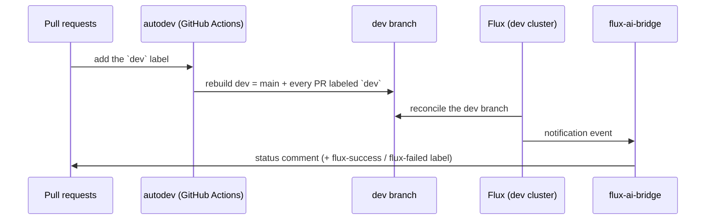

# The autodev workflow (recommended)

[autodev](https://github.com/Staffbase/autodev-action) is the recommended way to use flux-ai-bridge. Pull requests are tested on a shared dev cluster before they merge, and the bridge reports the result back on each pull request.



1. A pull request gets the `dev` label.
2. autodev rebuilds the `dev` branch from `main` plus every open pull request labeled `dev`, as one merge commit.
3. Flux on the dev cluster reconciles the `dev` branch.
4. The bridge receives the Flux event, finds every pull request in that merge commit (through its parents, no annotations needed), and posts the cluster's verdict on each pull request that touched the Kustomization.

Removing the label, or closing or merging the pull request, rebuilds `dev` without it. Why Flux's own pull request commenters can't cover this flow: [vs. Flux's native PR commenters](vs-flux-native-pr-comments.md).

## 1. Add the autodev workflow to your infrastructure repository

`.github/workflows/autodev.yml`. It uses the workflow's own `GITHUB_TOKEN`; no personal access token or GitHub App is needed.

```yaml
name: Autodev

on:
  push:
    branches-ignore: [ dev ]
  pull_request:
    types: [ labeled, unlabeled, closed ]

permissions: {}

jobs:
  autodev:
    name: Build Dev Branch
    # Dependabot runs get a read-only token; label events only for the dev label.
    if: github.actor != 'dependabot[bot]' && (github.event_name == 'push' || github.event.label.name == 'dev' || github.event.action == 'closed')
    runs-on: ubuntu-24.04
    # One run at a time, each on the current dev tip and labels. Job level, so
    # a skipped run (other label) can't replace a waiting rebuild; a newer
    # waiting rebuild replaces an older one, as every run rebuilds dev.
    concurrency:
      group: autodev
      cancel-in-progress: false
    permissions:
      contents: write # force-push the dev branch
      pull-requests: write # list the labeled PRs
      issues: write # set the successful/failed labels
    steps:
      # autodev pushes with the checkout's credentials (the GITHUB_TOKEN).
      - name: Checkout
        uses: actions/checkout@3d3c42e5aac5ba805825da76410c181273ba90b1 # v7.0.1
        with:
          fetch-depth: 0
          fetch-tags: false

      # autodev merges this repository's branch of the same name, so a fork
      # pull request would be marked successful for another branch. Take the
      # dev label off fork pull requests first. A fork's own label event runs
      # with a read-only token: the removal fails there, and so does the run,
      # before autodev.
      - name: Remove the dev label from fork pull requests
        env:
          GH_TOKEN: ${{ secrets.GITHUB_TOKEN }}
          REPO: ${{ github.repository }}
        shell: bash
        run: |
          forks=$(gh pr list --repo "$REPO" --label dev --state open --limit 1000 \
            --json number,isCrossRepository --jq '.[] | select(.isCrossRepository) | .number')
          for pr in $forks; do
            echo "::warning::#$pr is from a fork; removing its dev label"
            gh api --method DELETE "repos/$REPO/issues/$pr/labels/dev" > /dev/null
            gh api "repos/$REPO/issues/$pr/comments" > /dev/null \
              -f body="Removed the \`dev\` label: this pull request comes from a fork, and autodev merges branches of this repository by name, so it would test another branch. Push the branch to this repository and open the pull request from there to test it on \`dev\`." \
              || echo "::warning::could not comment on #$pr"
          done

      - name: Autodev
        uses: Staffbase/autodev-action@4d7207fa767390412b2febe6de0e9f4bc0e9c776 # v2.12.0
        with:
          token: ${{ secrets.GITHUB_TOKEN }}
          labels: true
          user: github-actions[bot]
          email: 41898282+github-actions[bot]@users.noreply.github.com
```

- With `labels: true`, autodev marks each pull request `successful` or `failed` for its **merge** into `dev`. The bridge's `flux-*` labels report the **deployment**; the two sets are independent.
- Don't protect the `dev` branch against force-pushes: autodev rebuilds it on every run.
- autodev merges each pull request's branch from this repository (`origin/<branch>`), by branch name. For a pull request from a fork, that would be a branch of the same name here (a fork's `main`, for example), and autodev would mark the fork's pull request `successful` for it. So the step before autodev removes the `dev` label from every open fork pull request and comments why. The label event of a fork's pull request gets a read-only `GITHUB_TOKEN`: that run can't remove the label and fails before autodev; the next run with a write token (any push) removes it. Push the branch to the repository instead.
- A push made with the `GITHUB_TOKEN` doesn't start other workflows. Flux pulls `dev` itself, so this doesn't matter for deployments. If a workflow must run on `dev` (an image build, for example), start it from the autodev job with `gh workflow run <workflow> --ref dev` (needs `actions: write`); see this repository's own [autodev workflow](../.github/workflows/autodev.yml).

## 2. Point the dev cluster at the dev branch

The dev cluster's `GitRepository` (or the source of your `flux bootstrap`) tracks `dev` instead of `main`:

```yaml
apiVersion: source.toolkit.fluxcd.io/v1
kind: GitRepository
metadata:
  name: flux-system
  namespace: flux-system
spec:
  ref:
    branch: dev
  # url, interval, secretRef as before
```

## 3. Install the bridge on the dev cluster

Install the bridge as described in [Getting Started](getting-started.md). Settings that fit the autodev flow:

```yaml
config:
  github:
    labels:
      # flux-success / flux-warning / flux-failed on each PR, aggregated across
      # every Kustomization it touches: usable as a merge gate.
      enabled: true
```

Large autodev batches merge many pull requests at once; [caching.md](caching.md) explains how the bridge stays inside GitHub's API rate limit, and [Tuning for very large autodev batches](caching.md#tuning-for-very-large-autodev-batches) what to adjust.

## Day to day

1. Open a pull request against `main` and add the `dev` label.
2. Wait for the bridge's comment: ✅ the change deployed cleanly on the dev cluster, ❌ or ⚠️ with the failing resources (and, with an LLM, the root cause and next steps).
3. Push fixes to the same branch; autodev rebuilds `dev` and the bridge updates its comment.
4. Merge when it's green. Merging or closing the pull request removes it from `dev`.
